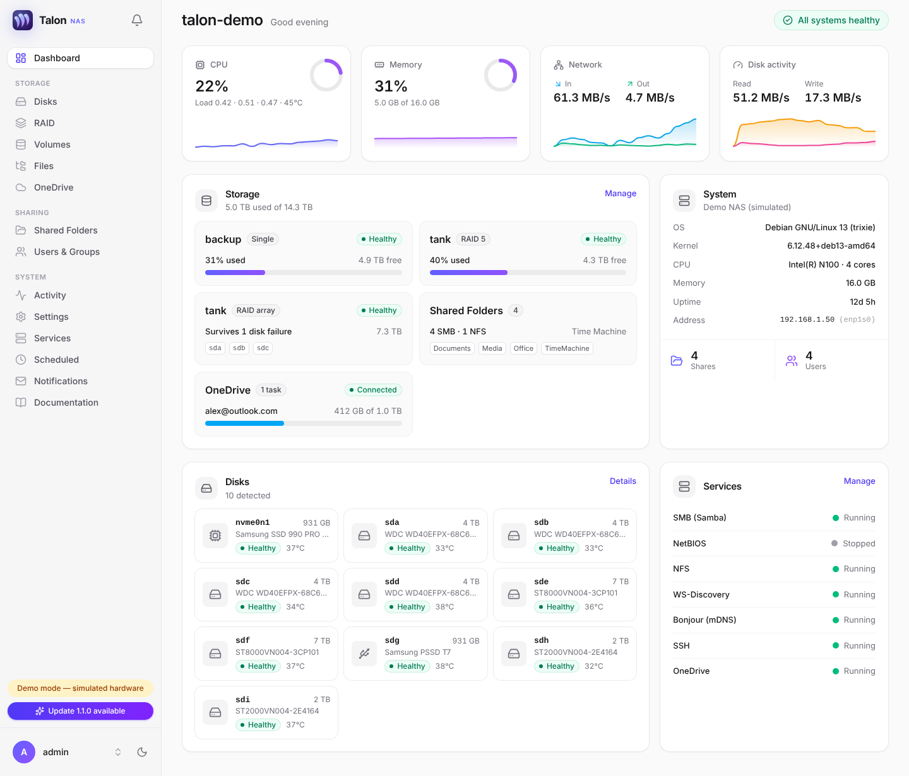

<p align="center"></p>

<h1 align="center">Talon</h1>

Turn any Debian/Ubuntu computer — x86 PC, mini-PC or Raspberry Pi — into a NAS with a modern web interface for disks, software RAID, shared folders and users.



## Install (single command)

```bash
curl -fsSL https://raw.githubusercontent.com/claudeailab/Talon/main/install.sh | sudo bash
```

Then open `https://<nas-ip>/` and sign in with the Linux account you ran the command as (its normal password). The certificate is self-signed, so accept the browser warning once.

Re-running the same command upgrades Talon and keeps your settings.

| Supported OS | Architectures |
|---|---|
| Debian 12 (bookworm), 13 (trixie) | amd64, arm64 |
| Ubuntu Server 22.04, 24.04, 26.04 LTS | amd64, arm64 |
| Raspberry Pi OS 64-bit (bookworm, trixie) — Pi 3/4/5 | arm64 |

Options (environment variables before `bash`): `TALON_PORT=8443`, `TALON_ADMIN=<user>`, `TALON_REF=<branch|tag>`.

## Features

- **Volumes & RAID** (Linux `mdadm` software RAID + ext4 or XFS). The wizard only offers layouts your disk count supports, with usable capacity and fault tolerance shown before anything is erased:

  | Disks | Layouts offered |
  |---|---|
  | 1 | Single disk |
  | 2 | RAID 0, RAID 1 |
  | 3 | RAID 0, RAID 1, RAID 5 |
  | 4+ (up to 50 and beyond) | RAID 0, RAID 1, RAID 5, RAID 6, RAID 10 |

  Hot spares, add disk / expand capacity (RAID 1/5/6), replace failed disk, remove disk, data scrub, filesystem expansion, live rebuild/sync progress.
- **Disks**: model, serial, type (HDD/SSD/NVMe/USB/SD), S.M.A.R.T. health, temperature, attributes, self-tests, secure wipe. The OS disk is detected and protected.
- **Shared folders**: SMB/CIFS (Windows, macOS, Linux, mobile) and NFS v3/v4. Per-user and per-group *No access / Read / Read-Write*, guest read access, recycle bin, macOS Time Machine, NFS client networks and user mapping.
- **Users & groups**: NAS users are Linux accounts without shell access; Samba passwords are kept in sync. Administrators can sign in to the web UI.
- **Discovery**: appears automatically in Windows Network (WS-Discovery) and macOS Finder (Bonjour).
- **Dashboard**: live CPU, memory, network, disk I/O, temperatures, storage health and alerts. Light and dark mode, works on phones.


## Updates

Talon checks this repository's [GitHub Releases](https://github.com/claudeailab/Talon/releases) every 6 hours. When a newer version exists, an **Update available** button appears in the top bar; **Settings → Software update** shows the release notes and installs it with one click.

What happens during an update:

1. The release archive is downloaded from GitHub and checked (expected files, matching version).
2. The current app and its Python environment are backed up.
3. The release's own `install.sh` runs in upgrade mode. It only installs *missing* system packages, so Samba and NFS are not upgraded or restarted and connected clients are not interrupted.
4. Talon restarts and the updater waits until the new version answers. If anything fails, the backup is restored automatically.

The updater runs in its own systemd unit, so restarting the web service cannot interrupt it. While it runs, the web interface shows a progress screen that:
- keeps working through the restart;
- keeps you signed in (sessions persist across restarts);
- still appears if you reload the page or open another tab;
- reloads into the new version by itself when the update finishes.

**Publishing a release (maintainers):** raise `__version__` in `backend/talon/__init__.py`, rebuild the web UI (`cd frontend && npm run build`) and merge to `main`. The `Release` workflow creates the `vX.Y.Z` tag and GitHub Release automatically.

## How it works

| Part | Technology |
|---|---|
| Backend | Python 3 + FastAPI, runs as the `talon` systemd service |
| Frontend | React 19, TypeScript, Tailwind CSS 4, TanStack Query, built with Vite (pre-built, no Node.js needed on the NAS) |
| Storage | `mdadm`, `parted`, `mkfs.ext4` / `mkfs.xfs`, `/etc/fstab`, `smartctl` |
| Sharing | Samba, `nfs-kernel-server`, Avahi, wsdd |
| Login | PAM (the system's own password check), members of the `nasadmins` group |

Paths: app `/opt/talon`, config `/etc/talon`, state `/var/lib/talon`, volumes mounted at `/srv/nas/<volume>`. The original `smb.conf` is saved as `/etc/samba/smb.conf.talon-backup`.

Logs: `journalctl -u talon -f`

## Uninstall

```bash
sudo /opt/talon/uninstall.sh
```

Add `--purge` to also remove the configuration and stop publishing shares. Volumes, RAID arrays and data are never touched.

## Development

```bash
# backend in demo mode (simulated disks, nothing on your machine is changed)
cd backend && python3 -m venv .venv && .venv/bin/pip install -r requirements.txt pytest httpx
.venv/bin/python -m talon --demo --port 8080 --host 127.0.0.1   # login admin / talon
.venv/bin/python -m pytest tests

# frontend with hot reload (proxies /api to :8080)
cd frontend && npm install && npm run dev
npm run build    # writes the production UI into backend/talon/web
```
