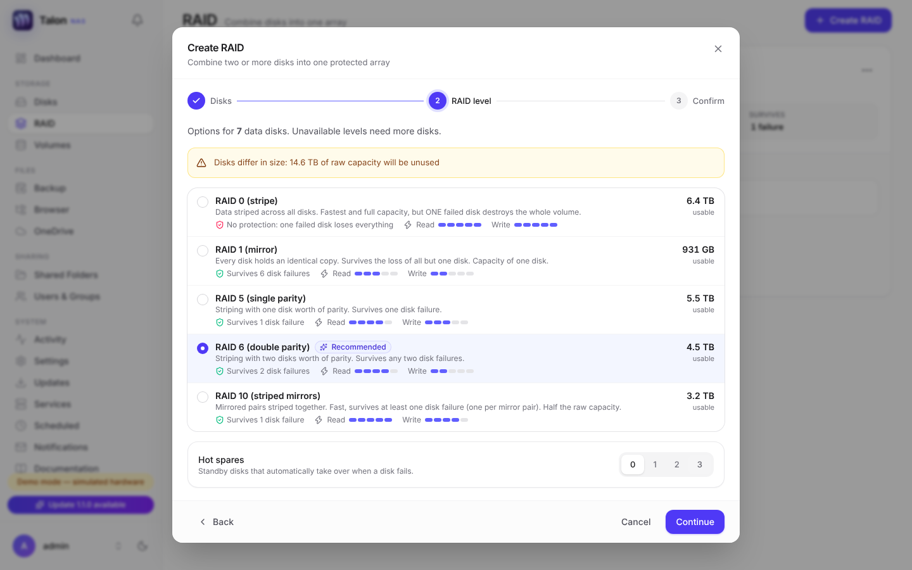
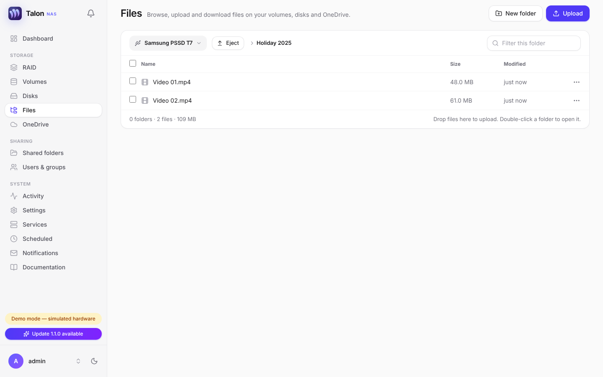
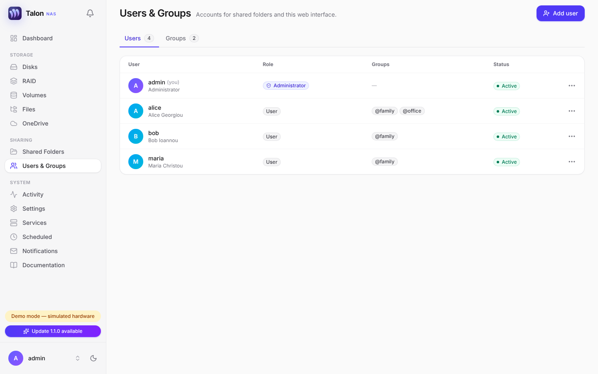
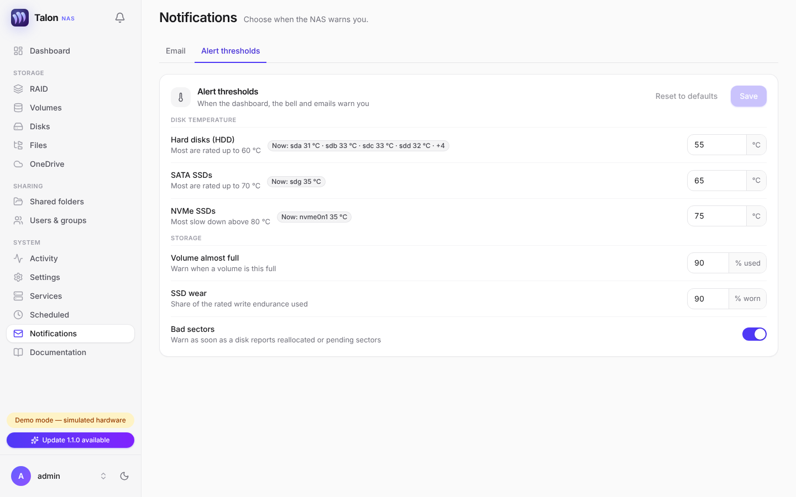
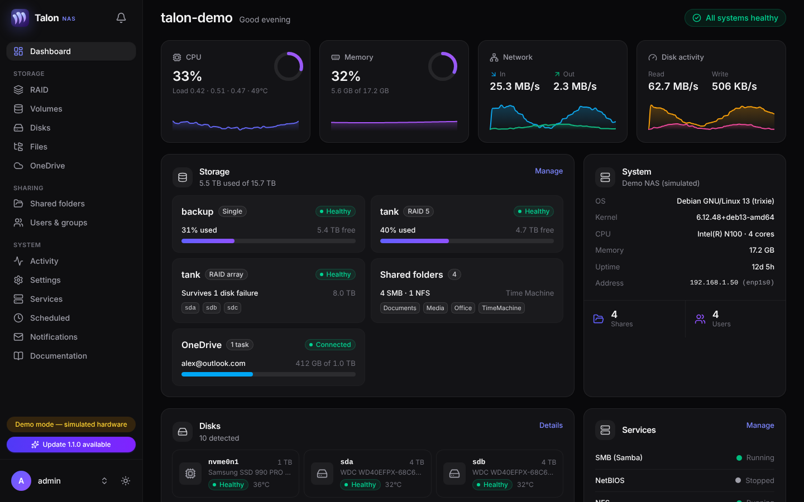

<picture>
  <source media="(prefers-color-scheme: dark)" srcset="docs/banner-dark.svg">
  
</picture>

---

**Talon is self-hosted NAS software for Debian, Ubuntu and Raspberry Pi OS.** It turns an ordinary PC, mini-PC or Raspberry Pi into a home NAS and file server that you manage entirely from your web browser.

Talon sets up Linux software RAID (mdadm), creates ext4 or XFS volumes, and shares folders with Windows, macOS and Linux over SMB (Samba) and NFS, including macOS Time Machine backups. It manages users and permissions, checks disk health with S.M.A.R.T., backs up or syncs folders with Microsoft OneDrive, and emails you when a disk or RAID array needs attention. One command installs it, and updates install from the web interface.

[](https://claudeailab.github.io/Talon/#dashboard)

## Install

```bash
curl -fsSL https://raw.githubusercontent.com/claudeailab/Talon/main/install.sh | bash
```

## Access

```text
https://<nas-ip>/
```

## Support

<div align="center">

| Supported OS | Architectures |
|---|---|
| Debian 12 (bookworm), 13 (trixie) | amd64, arm64 |
| Ubuntu Server 22.04, 24.04, 26.04 LTS | amd64, arm64 |
| Raspberry Pi OS 64-bit (bookworm, trixie) — Pi 3/4/5 | arm64 |

</div>

## Features

<div align="center">

| Disks | Layouts offered |
|---|---|
| 1 | Single disk |
| 2 | RAID 0, RAID 1 |
| 3 | RAID 0, RAID 1, RAID 5 |
| 4+ | RAID 0, RAID 1, RAID 5, RAID 6, RAID 10 |

</div>

- **RAID:** hot spares, expand, replace or remove disks, data scrub
- **Volumes:** ext4 or XFS, on a RAID array or a single disk
- **Files:** browse, upload, download, rename, move and delete files on volumes, USB disks and OneDrive
- **Disks:** S.M.A.R.T. health, temperature, self-tests, secure wipe
- **Shared folders:** SMB and NFS with per-user and per-group permissions
- **Users & groups:** NAS accounts with Samba passwords kept in sync
- **Discovery:** appears in Windows Network and macOS Finder
- **Dashboard:** live system stats, storage health and alerts
- **OneDrive:** back up to or from OneDrive, or two-way sync (beta)
- **Networking:** DHCP or a static IP, undone automatically if the NAS becomes unreachable
- **Scheduled:** run commands and scripts on a schedule, with output history
- **Notifications:** e-mail alerts for RAID, disks, tasks and updates
- **Documentation:** built-in searchable guide with steps and screenshots

## Screenshots

Click a screenshot to open the [gallery](https://claudeailab.github.io/Talon/).

<table>
  <tr>
    <td width="50%" align="center"><a href="https://claudeailab.github.io/Talon/#volumes"></a><br><sub>Volumes on RAID or single disks</sub></td>
    <td width="50%" align="center"><a href="https://claudeailab.github.io/Talon/#raid-wizard"></a><br><sub>RAID wizard with capacity and protection</sub></td>
  </tr>
  <tr>
    <td width="50%" align="center"><a href="https://claudeailab.github.io/Talon/#files"></a><br><sub>Files: browse, upload and download</sub></td>
    <td width="50%" align="center"><a href="https://claudeailab.github.io/Talon/#share-permissions"></a><br><sub>Shared folder permissions</sub></td>
  </tr>
  <tr>
    <td width="50%" align="center"><a href="https://claudeailab.github.io/Talon/#onedrive"></a><br><sub>OneDrive backup and sync</sub></td>
    <td width="50%" align="center"><a href="https://claudeailab.github.io/Talon/#users"></a><br><sub>Users and groups</sub></td>
  </tr>
  <tr>
    <td width="50%" align="center"><a href="https://claudeailab.github.io/Talon/#notifications"></a><br><sub>E-mail notifications</sub></td>
    <td width="50%" align="center"><a href="https://claudeailab.github.io/Talon/#dashboard-dark"></a><br><sub>Dark mode</sub></td>
  </tr>
</table>

## Updates

Updates are detected automatically and installed from the web interface.

## Uninstall

```bash
/opt/talon/uninstall.sh
```

Add `--purge` to also remove the settings. Your data is never touched.

## License

[MIT](LICENSE)
