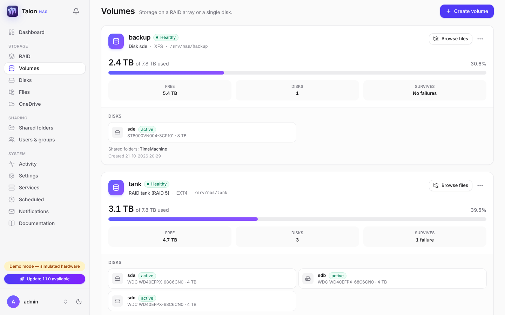
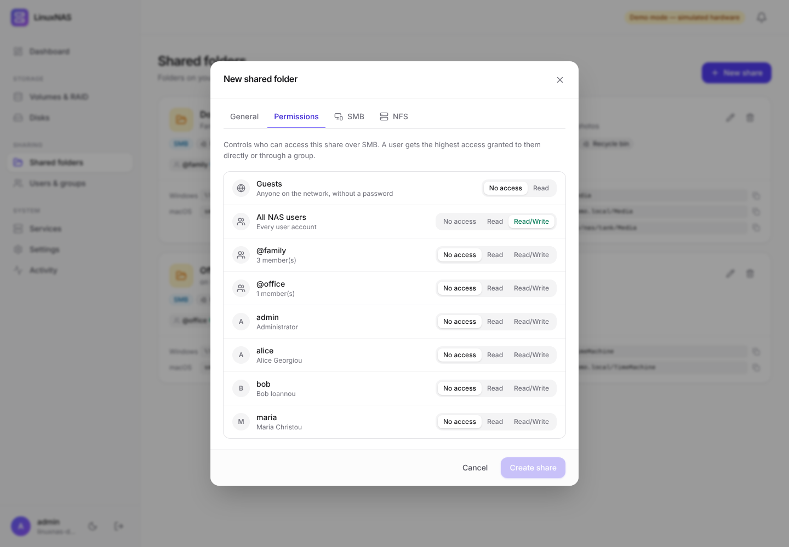
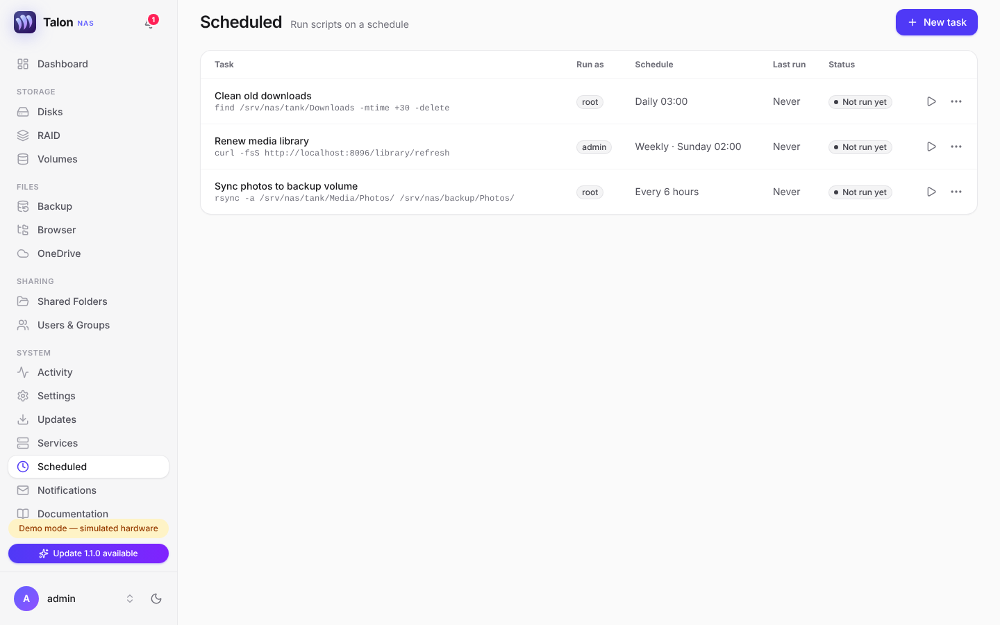
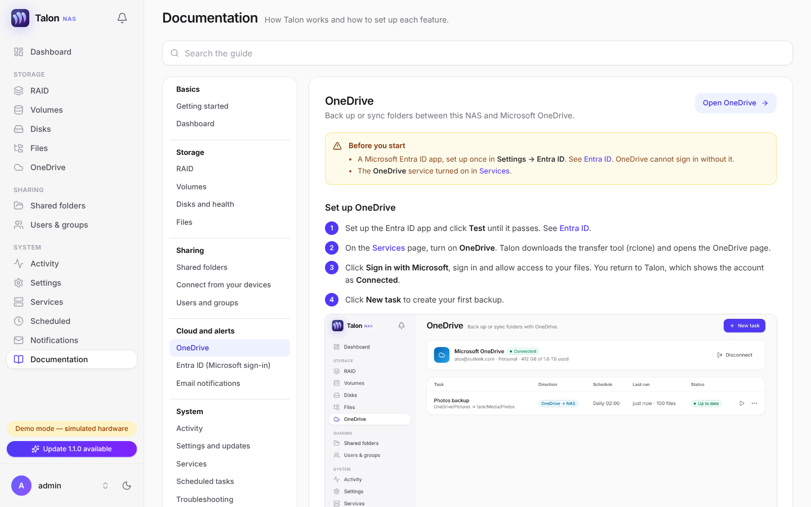

<picture>
  <source media="(prefers-color-scheme: dark)" srcset="docs/banner-dark.svg">
  
</picture>

---

**Talon is self-hosted NAS software for Debian, Ubuntu and Raspberry Pi OS.** It turns a PC, mini-PC or Raspberry Pi into a home NAS that you manage from your browser.

RAID, shared folders, users, OneDrive backup and alerts. One command installs it; updates install from the web interface.

[](https://claudeailab.github.io/Talon/#dashboard)

## Install

```bash
curl -fsSL https://raw.githubusercontent.com/claudeailab/Talon/main/install.sh | bash
```

## Access

```text
https://<nas-ip>/
```

## Support

<div align="center">

| Supported OS | Architectures |
|---|---|
| Debian 12 (bookworm), 13 (trixie) | amd64, arm64 |
| Ubuntu Server 22.04, 24.04, 26.04 LTS | amd64, arm64 |
| Raspberry Pi OS 64-bit (bookworm, trixie) — Pi 3/4/5 | arm64 |

</div>

## Features

<div align="center">

| Disks | Layouts offered |
|---|---|
| 1 | Single disk |
| 2 | RAID 0, RAID 1 |
| 3 | RAID 0, RAID 1, RAID 5 |
| 4+ | RAID 0, RAID 1, RAID 5, RAID 6, RAID 10 |

</div>

- **Dashboard:** live system stats, storage health and alerts
- **RAID:** hot spares, expansion, disk replacement and data scrub
- **Volumes:** ext4 or XFS on a RAID array or a single disk
- **Disks:** S.M.A.R.T. health, temperatures, self-tests and wipe
- **Files:** browse volumes, USB disks and OneDrive; restore deleted files and old versions
- **Shared folders:** SMB, NFS and Time Machine with per-user permissions
- **Users & groups:** accounts for shared folders and the web interface
- **Discovery:** appears in Windows Network and macOS Finder
- **OneDrive:** back up or two-way sync, set up in a short wizard, verified after each run
- **Networking:** DHCP or static IP, HTTPS on or off
- **Scheduled:** run scripts on a schedule
- **Notifications:** email alerts with adjustable thresholds
- **Documentation:** built-in searchable guide

## Screenshots

Click a screenshot to open the [gallery](https://claudeailab.github.io/Talon/).

<table>
  <tr>
    <td width="50%" align="center"><a href="https://claudeailab.github.io/Talon/#volumes"></a><br><sub>Volumes on RAID or single disks</sub></td>
    <td width="50%" align="center"><a href="https://claudeailab.github.io/Talon/#raid-wizard"></a><br><sub>RAID wizard</sub></td>
  </tr>
  <tr>
    <td width="50%" align="center"><a href="https://claudeailab.github.io/Talon/#files"></a><br><sub>Files on volumes, USB disks and OneDrive</sub></td>
    <td width="50%" align="center"><a href="https://claudeailab.github.io/Talon/#share-permissions"></a><br><sub>Shared folder permissions</sub></td>
  </tr>
  <tr>
    <td width="50%" align="center"><a href="https://claudeailab.github.io/Talon/#onedrive"></a><br><sub>OneDrive backup and sync</sub></td>
    <td width="50%" align="center"><a href="https://claudeailab.github.io/Talon/#users"></a><br><sub>Users and groups</sub></td>
  </tr>
  <tr>
    <td width="50%" align="center"><a href="https://claudeailab.github.io/Talon/#scheduled"></a><br><sub>Scheduled scripts</sub></td>
    <td width="50%" align="center"><a href="https://claudeailab.github.io/Talon/#notifications"></a><br><sub>Thresholds</sub></td>
  </tr>
  <tr>
    <td width="50%" align="center"><a href="https://claudeailab.github.io/Talon/#documentation"></a><br><sub>Built-in documentation</sub></td>
    <td width="50%" align="center"><a href="https://claudeailab.github.io/Talon/#dashboard-dark"></a><br><sub>Dark mode</sub></td>
  </tr>
</table>

## Updates

Updates are detected automatically and installed from the web interface.

## Uninstall

```bash
/opt/talon/uninstall.sh
```

Add `--purge` to also remove the settings. Your data is never touched.

## License

[MIT](LICENSE)
