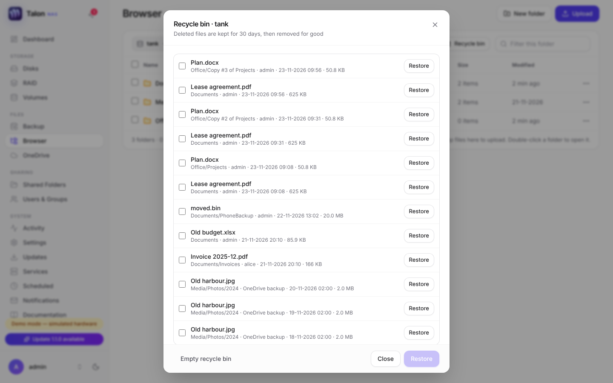
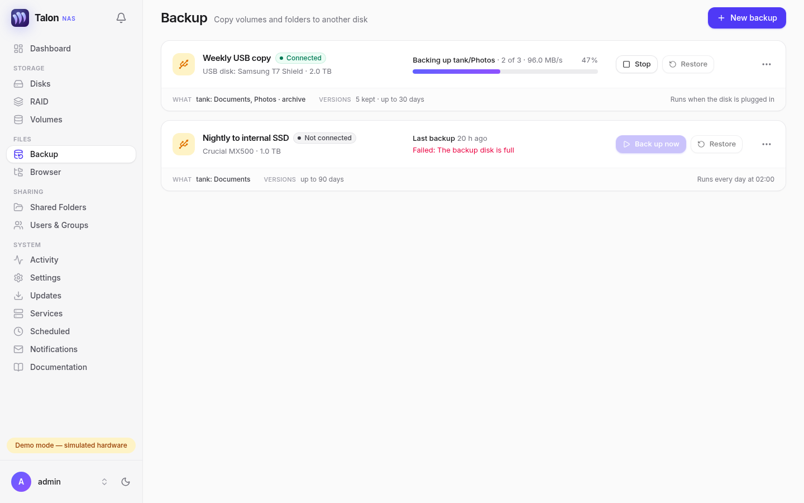
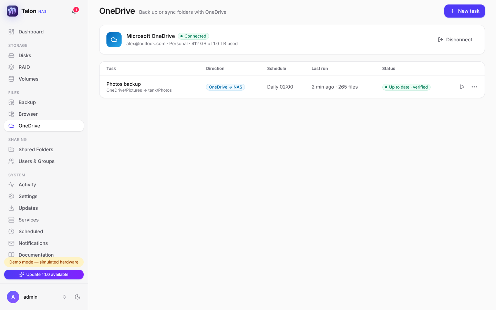
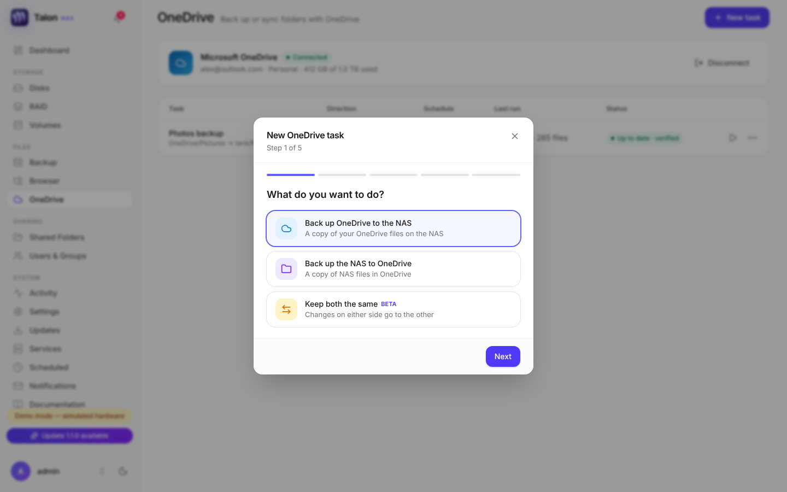
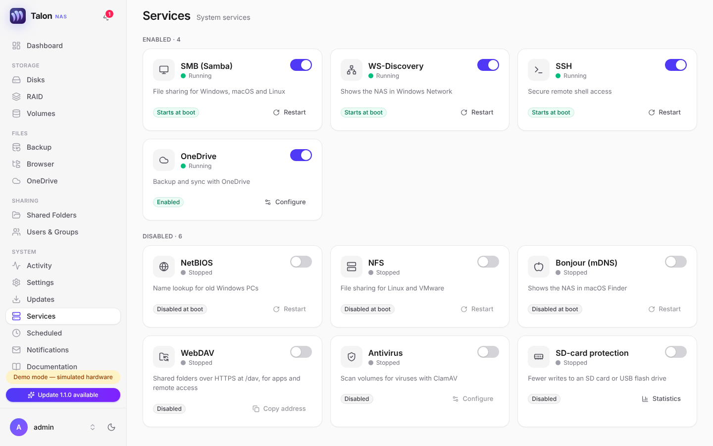
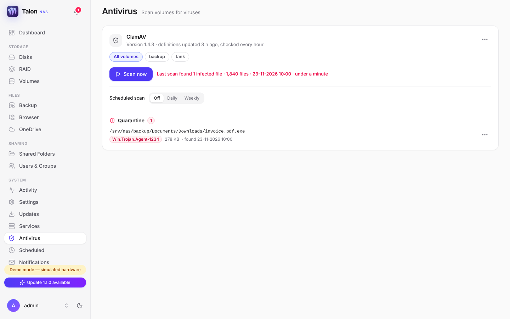
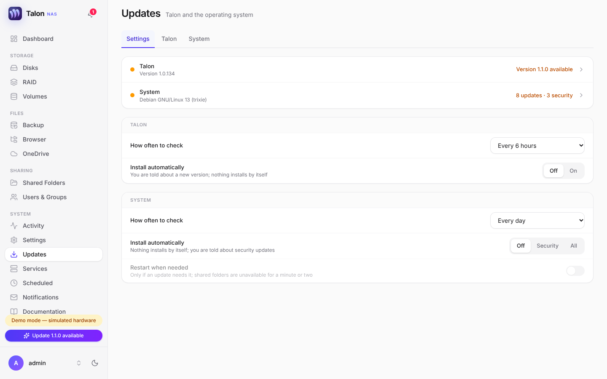
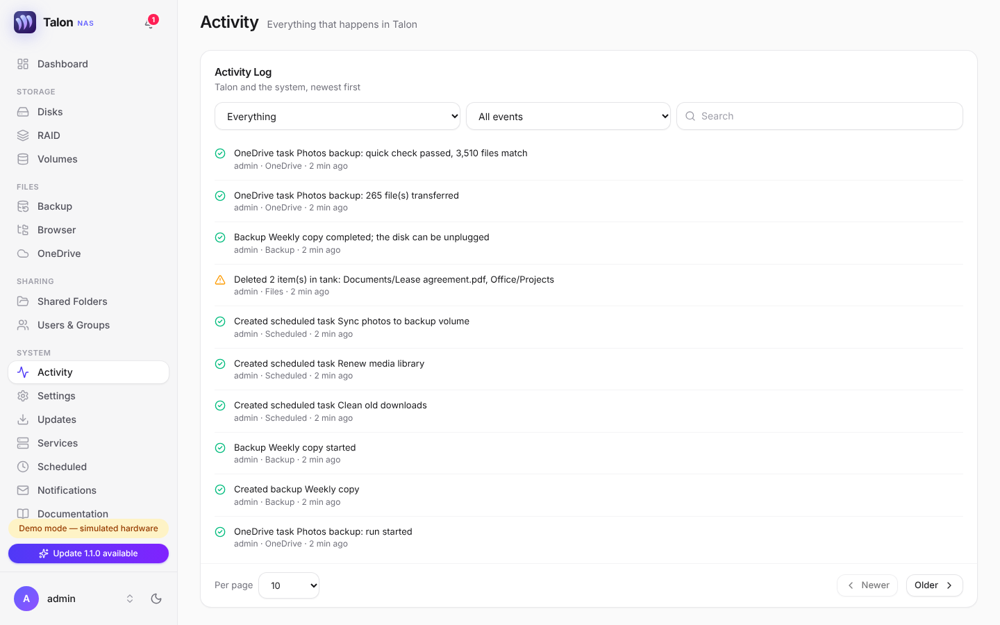

<picture>
  <source media="(prefers-color-scheme: dark)" srcset="docs/banner-dark.svg">
  
</picture>

---

**Talon is self-hosted NAS software for Debian, Ubuntu and Raspberry Pi OS.** It turns a PC, mini-PC or Raspberry Pi into a home NAS that you manage from your browser.

RAID, shared folders, users, OneDrive backup and alerts. One command installs it; updates install from the web interface.

[](https://claudeailab.github.io/Talon/screenshots.html#dashboard)

> [!WARNING]
> **Use at your own risk.** Talon is free software, provided as is, without any warranty. The authors are not responsible for any data loss.
>
> **Always keep a backup** of your important files on another device or in the cloud. **RAID is not a backup:** it keeps the NAS running when a disk fails, but it does not protect against deleted files, ransomware, theft, fire or a failed NAS.

## Install

```bash
curl -fsSL https://raw.githubusercontent.com/claudeailab/Talon/main/install.sh | bash
```

## Access

```text
https://<nas-ip>/
```

## Support

<div align="center">

| Supported OS | Architectures |
|---|---|
| Debian 12 (bookworm), 13 (trixie) | amd64, arm64 |
| Ubuntu Server 22.04, 24.04, 26.04 LTS | amd64, arm64 |
| Raspberry Pi OS 64-bit (bookworm, trixie) — Pi 3/4/5 | arm64 |

</div>

## Features

<div align="center">

| Disks | Layouts offered |
|---|---|
| 1 | Single disk |
| 2 | RAID 0, RAID 1 |
| 3 | RAID 0, RAID 1, RAID 5 |
| 4+ | RAID 0, RAID 1, RAID 5, RAID 6, RAID 10 |

</div>

- **Dashboard:** live system stats and storage health; issues in one place, the bell
- **Disks:** S.M.A.R.T. health, temperatures, self-tests and wipe
- **RAID:** hot spares, expansion, disk replacement and data scrub
- **Volumes:** ext4 or XFS on a single disk, or several on one RAID array, each with its own size
- **Backup:** to a USB or internal disk when plugged in or daily, with earlier versions
- **Browser:** browse volumes, other disks and OneDrive in the web interface
- **Recycle bin:** restore deleted files and earlier versions for 30 days
- **OneDrive:** backup or two-way sync, verified after each run
- **Shared Folders:** SMB, NFS and Time Machine, with folder permissions
- **WebDAV:** shared folders over HTTPS for apps and remote access
- **Users & Groups:** accounts and groups for shared folders and the web interface
- **Entra ID users:** people from your organization sign in with Microsoft
- **Discovery:** appears in Windows Network, and in macOS Finder with Bonjour on
- **Activity:** one searchable log of everything Talon and the system do
- **Usage history:** a year of CPU, memory, network, disk and storage graphs
- **Updates:** Talon and the operating system, each with its own schedule, optionally automatic
- **Antivirus:** ClamAV scans of volumes with quarantine
- **Network:** DHCP or static IP, HTTPS on or off
- **Scheduled:** scripts on a schedule, with live output and progress
- **SD cards:** fewer writes to an SD or USB flash system disk
- **Notifications:** email alerts with adjustable thresholds
- **Mobile:** works on phones and tablets, light and dark mode
- **Documentation:** built-in searchable guide

## Screenshots

Click a screenshot to open the [gallery](https://claudeailab.github.io/Talon/screenshots.html). More on the [website](https://claudeailab.github.io/Talon/).

<table>
  <tr>
    <td width="50%" align="center"><a href="https://claudeailab.github.io/Talon/screenshots.html#volumes"></a><br><sub>Volumes on RAID or single disks</sub></td>
    <td width="50%" align="center"><a href="https://claudeailab.github.io/Talon/screenshots.html#raid-wizard"></a><br><sub>RAID wizard</sub></td>
  </tr>
  <tr>
    <td width="50%" align="center"><a href="https://claudeailab.github.io/Talon/screenshots.html#files"></a><br><sub>Browser: volumes, USB disks and OneDrive</sub></td>
    <td width="50%" align="center"><a href="https://claudeailab.github.io/Talon/screenshots.html#recycle-bin"></a><br><sub>Recycle bin</sub></td>
  </tr>
  <tr>
    <td width="50%" align="center"><a href="https://claudeailab.github.io/Talon/screenshots.html#backup"></a><br><sub>Backup to a USB or internal disk</sub></td>
    <td width="50%" align="center"><a href="https://claudeailab.github.io/Talon/screenshots.html#onedrive"></a><br><sub>OneDrive backup and sync</sub></td>
  </tr>
  <tr>
    <td width="50%" align="center"><a href="https://claudeailab.github.io/Talon/screenshots.html#onedrive-wizard"></a><br><sub>OneDrive task wizard</sub></td>
    <td width="50%" align="center"><a href="https://claudeailab.github.io/Talon/screenshots.html#share-permissions"></a><br><sub>Shared folder permissions</sub></td>
  </tr>
  <tr>
    <td width="50%" align="center"><a href="https://claudeailab.github.io/Talon/screenshots.html#users"></a><br><sub>Users &amp; Groups</sub></td>
    <td width="50%" align="center"><a href="https://claudeailab.github.io/Talon/screenshots.html#services"></a><br><sub>Services</sub></td>
  </tr>
  <tr>
    <td width="50%" align="center"><a href="https://claudeailab.github.io/Talon/screenshots.html#antivirus"></a><br><sub>Antivirus</sub></td>
    <td width="50%" align="center"><a href="https://claudeailab.github.io/Talon/screenshots.html#updates"></a><br><sub>Updates</sub></td>
  </tr>
  <tr>
    <td width="50%" align="center"><a href="https://claudeailab.github.io/Talon/screenshots.html#activity"></a><br><sub>Activity log</sub></td>
    <td width="50%" align="center"><a href="https://claudeailab.github.io/Talon/screenshots.html#scheduled"></a><br><sub>Scheduled scripts</sub></td>
  </tr>
  <tr>
    <td width="50%" align="center"><a href="https://claudeailab.github.io/Talon/screenshots.html#notifications"></a><br><sub>Thresholds</sub></td>
    <td width="50%" align="center"><a href="https://claudeailab.github.io/Talon/screenshots.html#documentation"></a><br><sub>Built-in documentation</sub></td>
  </tr>
  <tr>
    <td width="50%" align="center"><a href="https://claudeailab.github.io/Talon/screenshots.html#dashboard-dark"></a><br><sub>Dark mode</sub></td>
    <td width="50%"></td>
  </tr>
</table>

## Updates

Updates are detected automatically and installed from the web interface.

## Uninstall

```bash
/opt/talon/uninstall.sh
```

Add `--purge` to also remove the settings. Your data is never touched.
